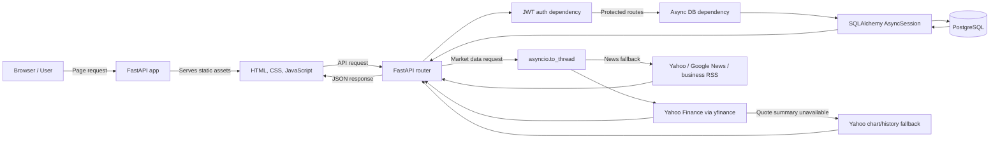

# First-Order 📈

A global stock-market research and watchlist app built with FastAPI and PostgreSQL.

Track stocks across 14 markets, browse stock-related headlines, and keep timestamped research notes with the quote captured when each note is written.

**Live:** https://first-order-a3v1.onrender.com/

This is a personal learning project, not a trading platform or financial advice. Quotes and headlines come from third-party sources and may be delayed, incomplete, or unavailable.

---

## What It Does

- **Watchlist** — add any stock by symbol, auto-created if not in database
- **Latest available quotes** — fetches Yahoo Finance data for supported symbols
- **Market news** — stock-related headlines from Yahoo Finance, with Yahoo/Google News and business RSS fallbacks
- **Global overview** — 14 major indices, fetched with bounded concurrency
- **Research notes** — private notes per stock with price automatically captured at creation time
- **Auth** — JWT + Argon2 password hashing, full register/login flow

---

## Tech Stack

| Layer | Tech |
|---|---|
| Framework | FastAPI |
| Database | PostgreSQL (async via asyncpg) |
| ORM | SQLAlchemy 2.0 (Mapped / mapped_column style) |
| Migrations | Alembic |
| Auth | PyJWT + pwdlib (Argon2) |
| Market Data | yfinance + curl_cffi + feedparser (Yahoo/Google News and RSS sources) |
| Config | pydantic-settings |
| Container | Docker + docker-compose |
| Deploy | Render + UptimeRobot |

---

## Symbol Format by Market

Yahoo Finance uses exchange suffixes. Here's what to use per market:

| Market | Suffix | Example |
|---|---|---|
| India (NSE) | `.NS` | `RELIANCE.NS`, `TCS.NS`, `HAL.NS` |
| India (BSE) | `.BO` | `RELIANCE.BO` |
| USA | *(none)* | `AAPL`, `NVDA`, `META` |
| Germany (XETRA) | `.DE` | `VOW3.DE`, `SAP.DE` |
| Japan (TSE) | `.T` | `7203.T` (Toyota), `6758.T` (Sony) |
| UK (LSE) | `.L` | `SHEL.L`, `HSBA.L` |
| Hong Kong | `.HK` | `0700.HK` (Tencent), `9988.HK` (Alibaba) |
| China (Shanghai) | `.SS` | `600519.SS` (Moutai) |
| China (Shenzhen) | `.SZ` | `000001.SZ` |
| Taiwan | `.TW` | `2330.TW` (TSMC) |
| South Korea | `.KS` | `005930.KS` (Samsung) |
| France (Euronext) | `.PA` | `MC.PA` (LVMH), `AI.PA` |
| Netherlands | `.AS` | `ASML.AS` |
| Canada (TSX) | `.TO` | `RY.TO`, `SU.TO` |

> **Note:** SME stocks, microcaps, and recently listed companies may have incomplete data on Yahoo Finance. Yahoo may also rate-limit cloud-hosted requests; some quote fields can be unavailable.

---

## API Endpoints

### Auth
```
POST /auth/register    — create account
POST /auth/login       — returns JWT token
GET  /auth/me          — current user profile (protected)
```

### Watchlist (protected)
```
GET    /watchlist/            — get your full watchlist
POST   /watchlist/{symbol}    — add a stock (e.g. /watchlist/RELIANCE.NS)
DELETE /watchlist/{symbol}    — remove a stock
```

### Market (public)
```
GET /market/price/{symbol}       — latest available quote, change %, volume, 52-week range
GET /market/news/{symbol}        — recent headlines for a stock
GET /market/overview             — latest available snapshot of 14 global indices
GET /market/stocks/search?q=...  — search stocks in database by name or symbol
```

### Research Notes (protected)
```
POST   /notes/{symbol}           — create note (price captured automatically)
GET    /notes/                   — all your notes across all stocks
GET    /notes/stock/{symbol}     — all notes for a specific stock
PATCH  /notes/{note_id}          — update a note
DELETE /notes/{note_id}          — delete a note
```

### Health
```
GET /health    — service status
```

---

## How to Try It Live

**1. Open the docs:**
https://first-order-a3v1.onrender.com/docs

**2. Register an account:**
- Go to `POST /auth/register`
- Click *Try it out*
- Fill in email, username, password
- Execute

**3. Login and get your token:**
- Go to `POST /auth/login`
- Click *Try it out*
- Fill in email and password
- Execute
- Copy the `access_token` from the response

**4. Authorize:**
- Click the **Authorize** button at the top of the page
- In the **username** field, enter your **email** (OAuth2 form maps it this way)
- Enter your password
- Click Authorize

You're now logged in. All protected endpoints (watchlist, notes, /me) will work.

**5. Try some endpoints:**
```
GET /market/price/RELIANCE.NS      — Reliance Industries live price
GET /market/price/AAPL             — Apple live price
GET /market/news/TCS.NS            — TCS latest news
GET /market/overview               — all 14 global indices
POST /watchlist/HAL.NS             — add HAL to your watchlist
POST /notes/CDSL.NS                — write a research note on CDSL
```

> **Note:** The free Render tier spins down after inactivity. First request may take ~30 seconds if the service is cold. Subsequent requests are fast.

---

## Run Locally with Docker

```bash
git clone https://github.com/ah4ddd/first-order
cd first-order

# Copy and fill in your environment variables
cp .env.example .env

# Start everything
docker compose up --build

# In a second terminal — run migrations and seed data
docker compose exec -w /app/app api alembic upgrade head
docker compose exec api python -m app.seed_stocks
```

Open http://localhost:8000/docs

Before starting Compose, make sure `.env` defines `POSTGRES_USER`, `POSTGRES_PASSWORD`, and `POSTGRES_DB` for the database container, and that `DATABASE_URL` uses the Compose hostname `db` with the same credentials and database name. These `POSTGRES_*` variables are required by `docker-compose.yml`.

### Environment Variables

```env
DATABASE_URL=postgresql+asyncpg://postgres:yourpassword@db/first_order
SECRET_KEY=your-32-byte-hex-key   # generate with: openssl rand -hex 32
ALGORITHM=HS256
ACCESS_TOKEN_EXPIRE_MINUTES=30
APP_NAME=First-Order
DEBUG=True
POSTGRES_USER=first_order
POSTGRES_PASSWORD=change-this-password
POSTGRES_DB=first_order
```

---

## Project Structure

```
first-order/
├── app/
│   ├── main.py              — FastAPI app, middleware, router registration
│   ├── config.py            — pydantic-settings config
│   ├── database.py          — async engine, session factory, get_db dependency
│   ├── db_models.py         — SQLAlchemy 2.0 table models (Mapped style)
│   ├── models.py            — Pydantic request/response schemas
│   ├── dependencies.py      — JWT auth dependency, CurrentUser type alias
│   ├── utils.py             — get_or_create_stock, country inference
│   ├── seed_stocks.py       — initial stock data seeder
│   ├── alembic/             — database migrations
│   ├── services/
│   │   └── rss_news.py      — RSS feed fetcher (news fallback)
│   └── routers/
│       ├── auth.py          — register, login, /me
│       ├── watchlist.py     — watchlist CRUD
│       ├── market.py        — prices, news, overview, search
│       └── notes.py         — research notes CRUD
├── Dockerfile
├── docker-compose.yml
└── requirements.txt
```

---

## Architecture



---

## Architecture Notes

**Async throughout** — uses `AsyncSession` from SQLAlchemy 2.0 and `asyncpg` driver. Every database call is non-blocking.

**yfinance in threadpool** — yfinance is synchronous. All calls are wrapped with `asyncio.to_thread` so the event loop stays free under concurrent requests.

**Bounded index fetching** — the market overview endpoint fetches 14 indices with at most four requests in flight at a time. Chart requests retry up to three times when Yahoo returns no data.

**Market-data fallback** — quote details are requested from Yahoo Finance first. If Yahoo rejects the quote-summary request, price routes fall back to Yahoo chart/history data. Overview uses chart/history data directly. Chart fallback may not include profile fields such as sector, industry, or market cap.

**In-memory caching** — prices cache for 60 seconds, news for 5 minutes, overview for 2 minutes. Prevents hammering external APIs on repeated requests.

**Get-or-create stocks** — when a user adds a symbol to their watchlist or creates a note, if the stock isn't in the database yet it gets created automatically by fetching metadata from yfinance. No manual seeding needed for new symbols.

**Price snapshot on notes** — when a research note is created, the current market price is captured and stored permanently. Lets you see what price you were looking at when you wrote the thesis.

**RSS fallback for news** — if yfinance news is unavailable, the news endpoint tries Yahoo Finance ticker RSS and Google News RSS searches, then searches the configured BBC Business, CNBC, and Moneycontrol feeds.

---

## Known Limitations

- **Yahoo Finance rate limiting** — Yahoo may block or throttle requests from cloud provider IPs. Price routes use chart/history fallback, but if all providers fail the endpoint can still return an error or unavailable data. News uses RSS fallbacks.
- **Free tier cold starts** — Render free tier spins down after 15 minutes of inactivity. UptimeRobot pings every 5 minutes to mitigate this.
- **No real-time streaming** — prices are fetched on request, not pushed. Refresh the endpoint to get updated data.
- **Indian SME stocks** — small/micro caps and recently listed companies may have incomplete metadata on Yahoo Finance.

---

## About

Built by Ahad ([@ah4ddd](https://github.com/ah4ddd))

This is my first real FastAPI portfolio project, built over a year of learning by doing.
